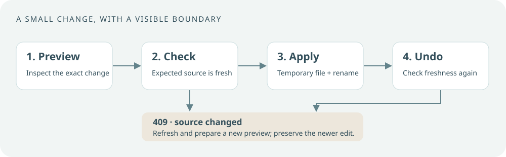

# Architecture

Personal OS is a local web application around readable Markdown. Local SQLite serves search, caches and technical state only. The browser talks to a loopback HTTP server. A second, read-only MCP stdio entry point gives a configured client selected access to the same workspace and context libraries. Shared libraries own parsing, persistence, retrieval and optional integrations.

## A bounded write is easier to trust

Markdown tasks, project notes, Inbox capture and weekly review use explicit scope. A supported operation begins with a preview, verifies the expected source version and applies a targeted change. A stale source produces **HTTP 409** so the user can refresh rather than overwrite a newer edit.

Line-based task changes retain source-line references rather than reconstructing the document from parsed objects. Atomic writes use a temporary file followed by a rename. Session undo also checks freshness: it must not erase someone else's later edit.

This is a consistency boundary, not a claim that arbitrary multi-process changes form a database transaction. Obsidian, sync software and another editor can still change a file; refresh and inspect when a conflict appears.

## Storage and backups

| Store | Authoritative content | Backup implication |
| --- | --- | --- |
| Main Vault Markdown | Tasks, project notes, Inbox, weekly review | Back up the explicitly configured files |
| Person-self-model / AI-Model Markdown | User-maintained guidance and selected context | Back up the chosen roots; dashboard context access is read-only |
| `private/profile.json` | Workspace preferences | Keep with your local configuration |
| Main Vault `Records/` and `Settings/` | Page records (Work, Home, Health, Library, Career, Learning, Future, Main, check-ins, local calendar) and preferences | Back up with the rest of your Markdown |
| Private SQLite databases | Retrieval index, revision bookkeeping, feed and native calendar caches | Rebuildable; deleting them loses no record |
| `private/storage-backups/` and local credential file | Pre-migration backups and private feed URLs | Keep private and outside Git |
| Browser page memory | Unsaved AI conversation, unfinished drafts, selected Rhythm anchor | Export or save through the interface before closing |

**Markdown is the source of truth.** Every page record is a Markdown file with small frontmatter and a fenced YAML `## Data` section, plus an optional free `## Notes` section. A save writes the file through `atomicWrite` before it reports success, and it is refused when the file changed since it was read, so an edit made in Obsidian is never silently overwritten. Records marked `selected-only` can be chosen as agent context; settings and agent sessions are excluded. The storage contract in the repository, `docs/storage-contract.md`, lists every record and path.

A first start after upgrading moves legacy SQLite page state into Markdown once, after a consistent SQLite backup in `private/storage-backups/`, and compares every record before switching. The old rows stay frozen for rollback. Keep `.env` secrets separate from any publicly shared backup. Documentation build output and its virtual environment can be rebuilt; personal databases cannot be reconstructed from the demo seed.

## Retrieval, selection and freshness

The current public path uses local SQLite FTS5 and BM25 over explicitly selected supported notes. It labels excerpts by vault and source line, excludes unselected notes and checks the prepared browser context's source freshness before a model request. HTTP retrieval uses a disk-backed local index; the read-only MCP process uses an in-memory SQLite index.

This is **keyword retrieval**, not semantic vector search. The original private architecture combines local embeddings with keyword search and reciprocal rank fusion; those properties and its benchmark numbers do not transfer automatically to this edition.

## External boundaries

Feed refreshes, native Apple access and AI sends are separate explicit actions. Cloud AI sends include the approved context. A local model endpoint is only as local as its configured URL and server. A downloaded session may later be uploaded elsewhere by the user or another tool.

A local-first application gives you inspectable storage and decisions. It does not make a connected cloud service local.

## Relationship to the original architecture

This project is informed by [What My Obsidian Dashboards Grew Into](https://tanya.engineer/blog/personal-os-architecture/). It preserves local files, narrow mutations, visible source references and deliberate boundaries. It replaces private identity and life data with generic connected examples.

The article describes five vaults, a richer hybrid index and a read-only MCP surface over shared libraries. This edition implements the two-door HTTP/MCP design with three generic roots and selected-note FTS retrieval. [MCP setup and exact tools](agent.md#connect-a-read-only-mcp-client) are documented separately. The article also describes tab state flowing back into Markdown; this edition keeps substantial page state in private SQLite instead. These are material differences, recorded in [Scope and verification](status.md), rather than claims of feature parity.
