# A look inside

A real local workspace, shown with fictional projects and demo records. These images show the standalone demo. The application still uses the name Personal OS; its repository is `your-os`.

These are interface illustrations, not an interactive hosted dashboard. Clock values, week dates, selected panels and lighting reflect the capture session. No private vault, owner key or personal conversation appears. Click an image for full resolution.

## Find your way

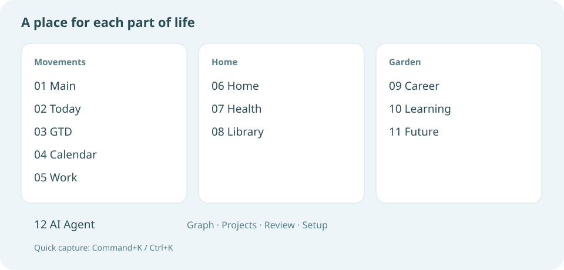

[Read the page guide](guide.md) for behavior, storage and limits.

<figure class="os-screen" id="screen-main"><a href="assets/screenshots/main.jpg">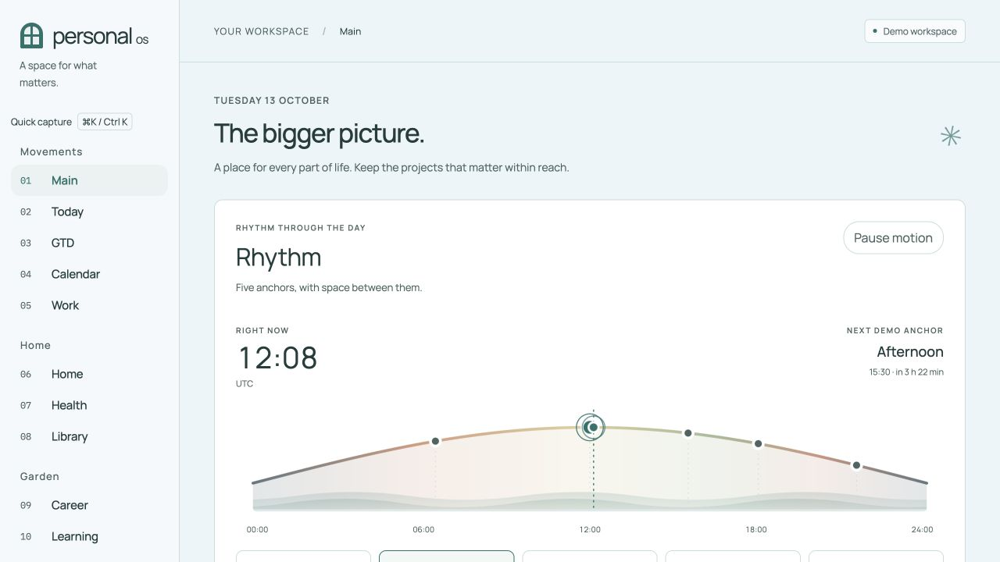</a><figcaption><h3>01 · Main</h3>
Rhythm, manual Energy and Mood, decisions and the current week.
</figcaption></figure>
<figure class="os-screen" id="screen-today"><a href="assets/screenshots/today.jpg">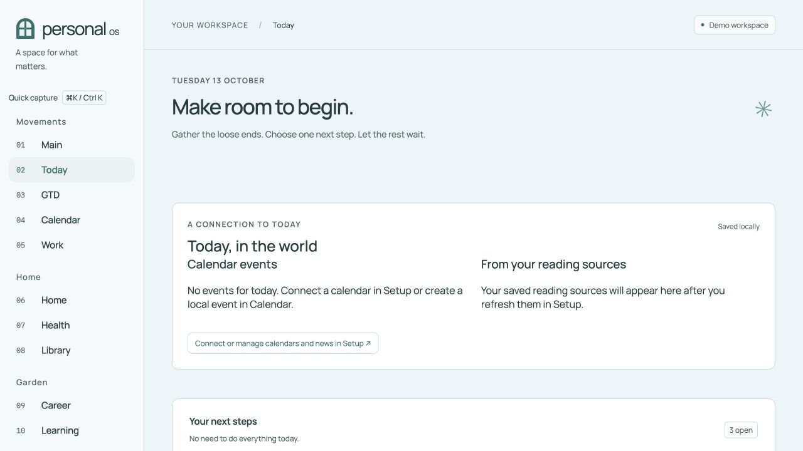</a><figcaption><h3>02 · Today</h3>
Tasks, cached calendar events and explicitly refreshed news.
</figcaption></figure>
<figure class="os-screen" id="screen-gtd"><a href="assets/screenshots/gtd.jpg">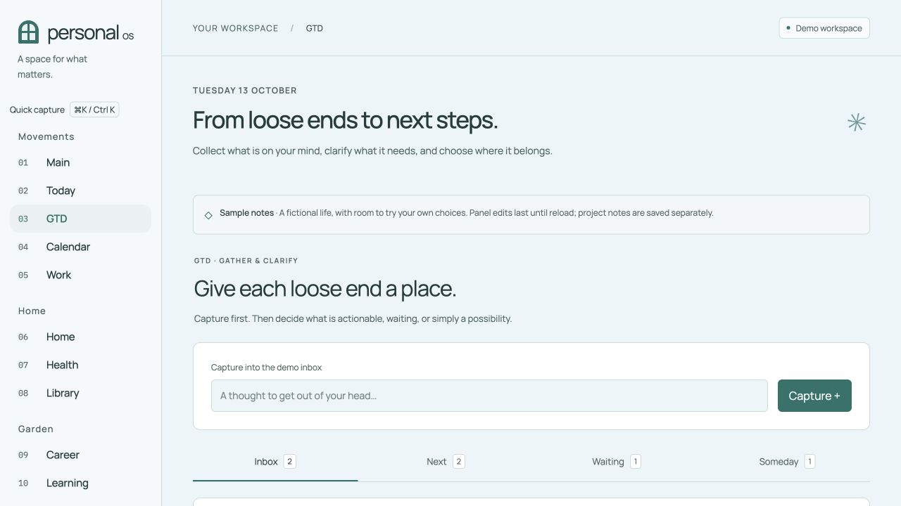</a><figcaption><h3>03 · GTD</h3>
Next, Waiting and Someday; preview supported Markdown changes.
</figcaption></figure>
<figure class="os-screen" id="screen-calendar"><a href="assets/screenshots/calendar.jpg">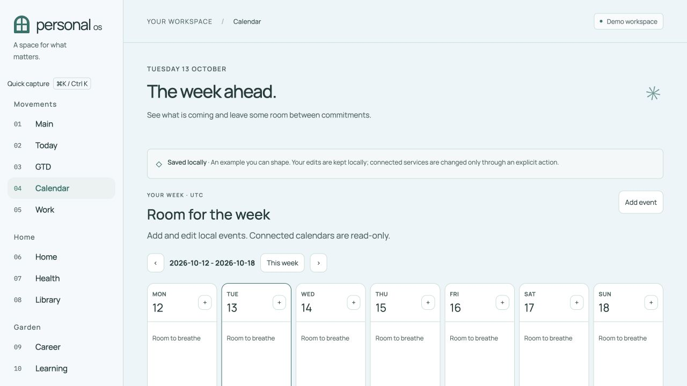</a><figcaption><h3>04 · Calendar</h3>
An editable local calendar alongside read-only connected events.
</figcaption></figure>
<figure class="os-screen" id="screen-work"><a href="assets/screenshots/work.jpg">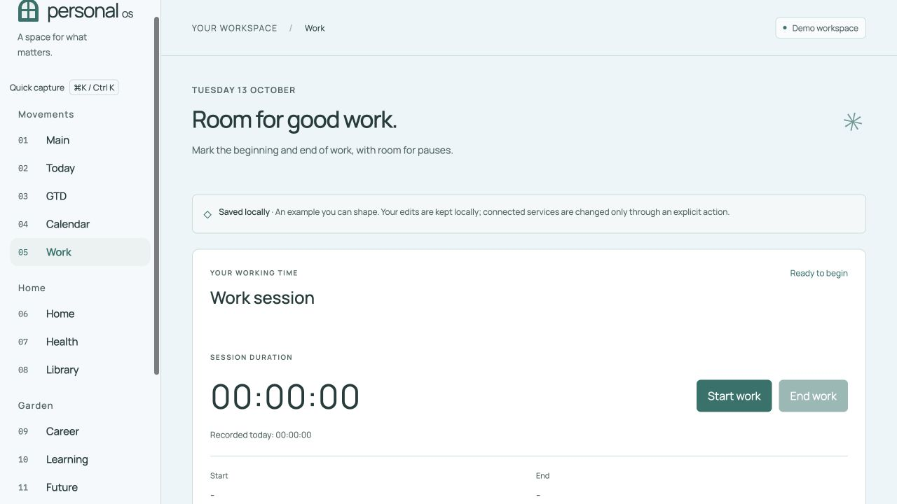</a><figcaption><h3>05 · Work</h3>
Work sessions, a configurable timer, dated records and meeting preparation.
</figcaption></figure>
<figure class="os-screen" id="screen-home"><a href="assets/screenshots/home.jpg">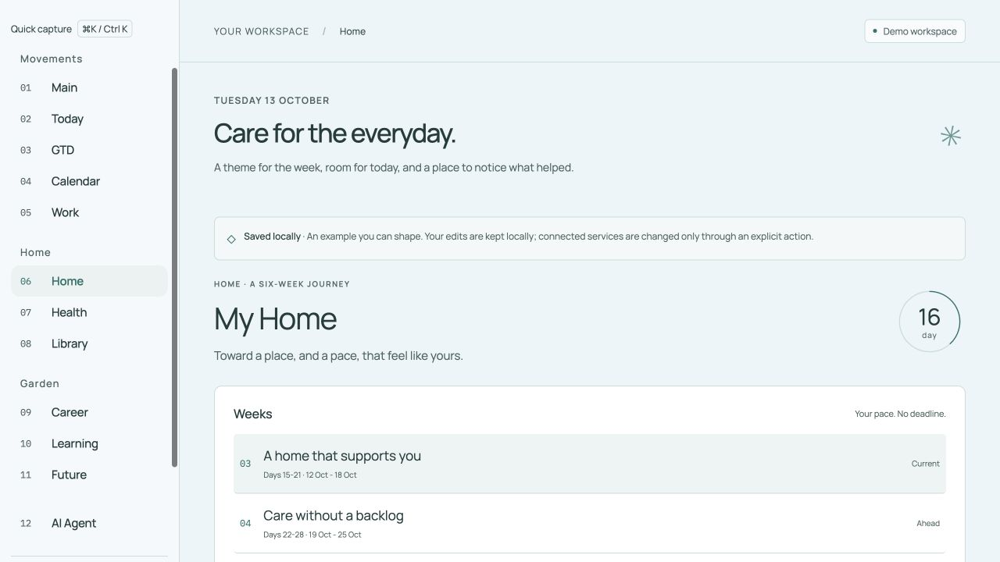</a><figcaption><h3>06 · Home</h3>
An evolving weekly home project, with a theme, focus and review.
</figcaption></figure>
<figure class="os-screen" id="screen-health"><a href="assets/screenshots/health.jpg">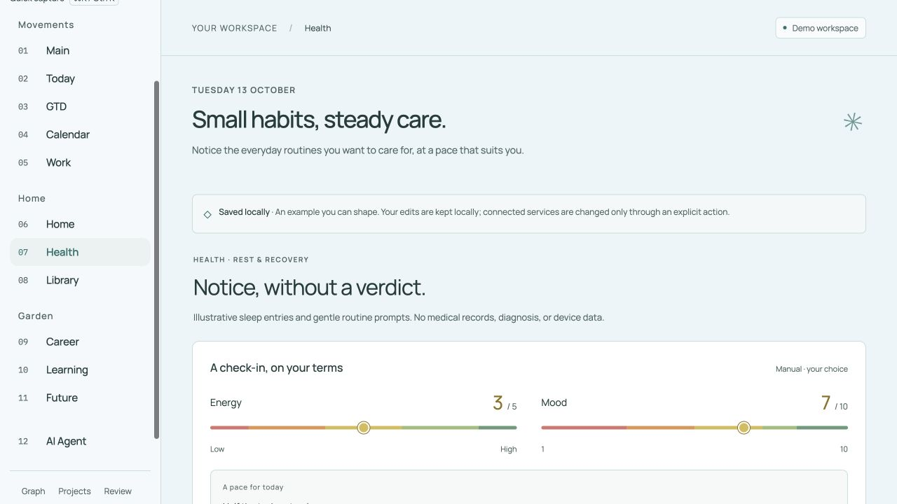</a><figcaption><h3>07 · Health</h3>
Manual sleep records, rest and difficulties falling asleep or waking.
</figcaption></figure>
<figure class="os-screen" id="screen-library"><a href="assets/screenshots/library.jpg">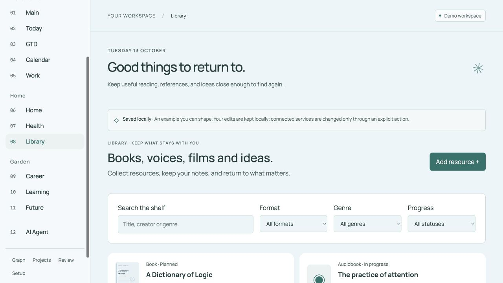</a><figcaption><h3>08 · Library</h3>
Books, audiobooks, videos, films, courses and articles on one shelf.
</figcaption></figure>
<figure class="os-screen" id="screen-career"><a href="assets/screenshots/career.jpg">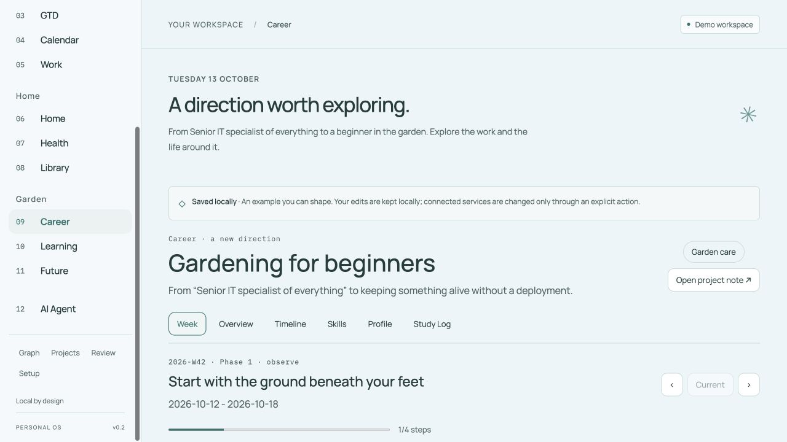</a><figcaption><h3>09 · Career</h3>
Six views for a fictional transition from IT to gardening and forest care.
</figcaption></figure>
<figure class="os-screen" id="screen-learning"><a href="assets/screenshots/learning.jpg">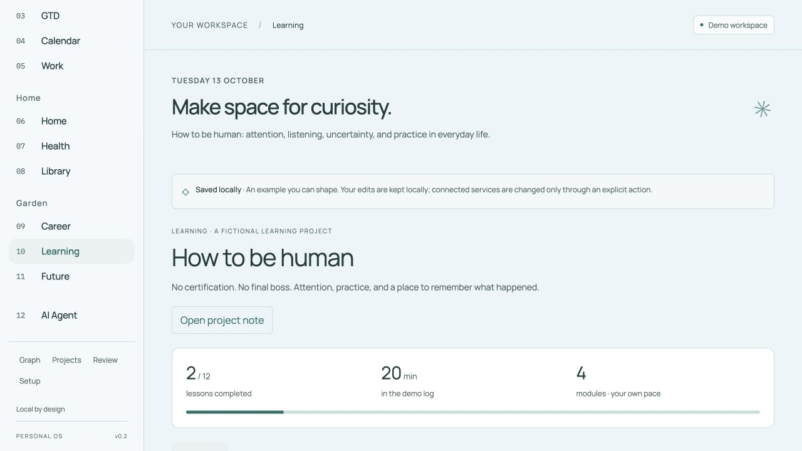</a><figcaption><h3>10 · Learning</h3>
How to be human: modules, weekly rotation and reflective practice.
</figcaption></figure>
<figure class="os-screen" id="screen-future"><a href="assets/screenshots/future.jpg">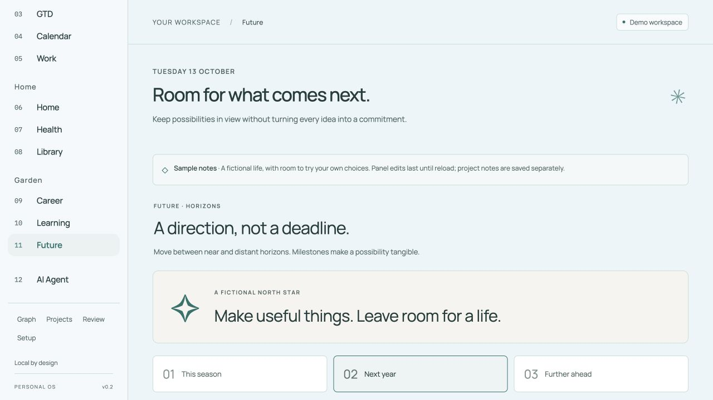</a><figcaption><h3>11 · Future</h3>
Possible directions after AI, with room to explore before committing.
</figcaption></figure>
<figure class="os-screen" id="screen-agent"><a href="assets/screenshots/agent.jpg">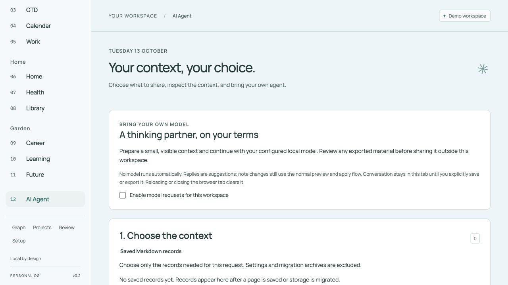</a><figcaption><h3>12 · AI Agent</h3>
Inspect selected context and source references before a local model send.
</figcaption></figure>
<figure class="os-screen" id="screen-review"><a href="assets/screenshots/review.jpg">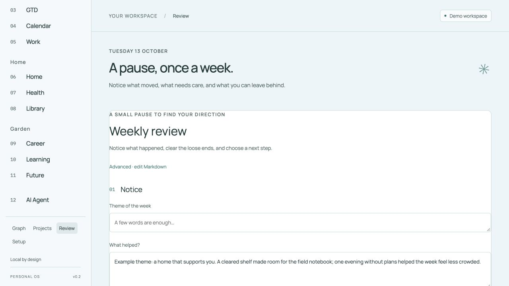</a><figcaption><h3>Weekly Review</h3>
A guided reflection form and separately reviewed candidate observations.
</figcaption></figure>
<figure class="os-screen" id="screen-setup"><a href="assets/screenshots/setup.jpg">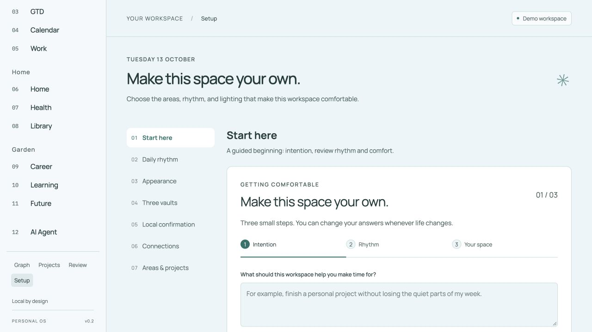</a><figcaption><h3>Setup</h3>
A guided beginning followed by rhythm, appearance, vaults and connections.
</figcaption></figure>
<figure class="os-screen" id="screen-library-detail"><a href="assets/screenshots/library-detail.jpg">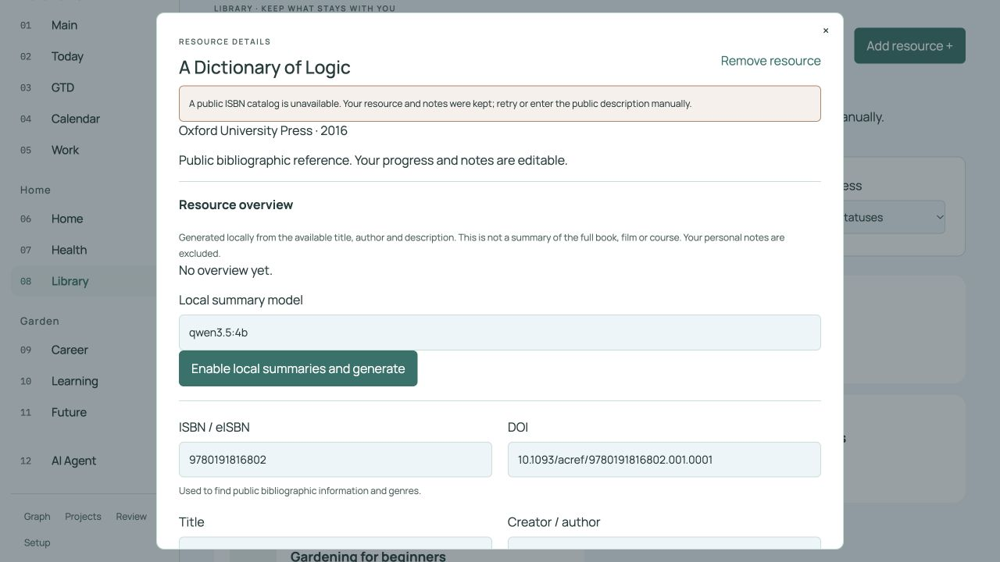</a><figcaption><h3>Inside a resource</h3>
Public bibliographic fields, your own notes and an optional local overview.
</figcaption></figure>
<figure class="os-screen" id="screen-quick-capture"><a href="assets/screenshots/quick-capture.jpg">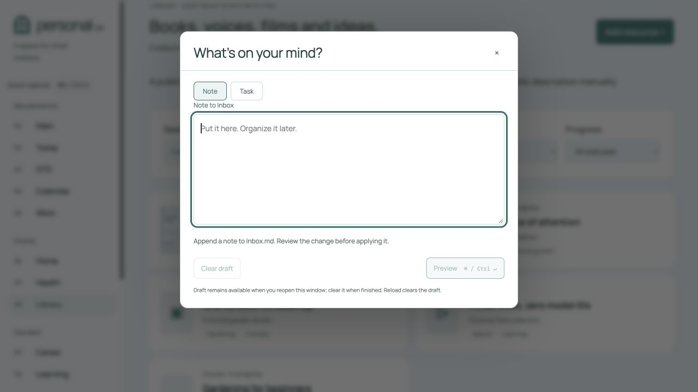</a><figcaption><h3>Quick capture</h3>
Command+K or Ctrl+K opens a note or task draft; preview the Markdown change.
</figcaption></figure>

## What the images establish

The screenshots show layout and invented records. They do not verify a connected Google account, Apple permissions, current catalog availability, a generated model answer or a real passkey ceremony. The Library detail uses a public bibliographic reference; no local model is configured in this capture environment. See [scope and verification](status.md).
