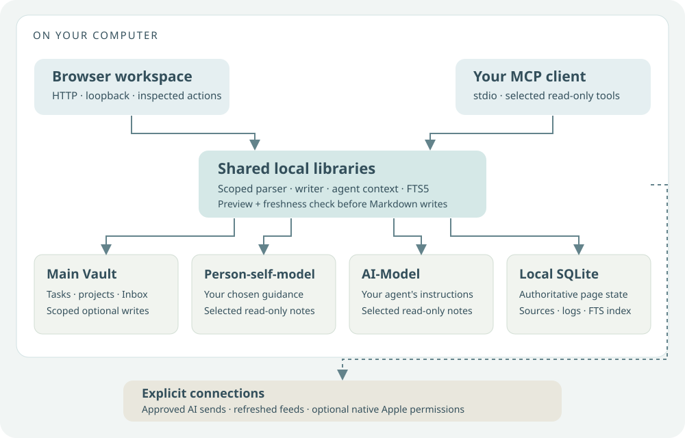

# Three vaults, distinct roles

A useful agent needs context, but context does not need to be one undifferentiated folder. This edition uses three generic spaces. It does not distribute an existing person's assistant identity or private corpus.



| Space | What belongs here | Application boundary |
| --- | --- | --- |
| Main Vault | Tasks, projects, Inbox capture, weekly review | Bounded read and optional previewed write scope |
| Person-self-model | Your chosen values, preferences, constraints, self-descriptions and reviewed observations about you | Selected context; observations only after your review |
| AI-Model | Guidance for how your own agent should respond, what requires confirmation, and reviewed observations about the agent | Selected context; observations only after your review |

These names describe roles. The example content is editable in your own files and should be replaced with your own decisions, not treated as a psychological profile.

## Demo roots

The launcher creates local fictional working copies in `private/demo-vault/`, `private/vaults/Person-self-model/` and `private/vaults/AI-Model/`. Setup shows the three roles and their guidance. Model-note previews render readable headings, lists and tables.

## Existing vault roots

Configure roots explicitly in ignored `.env`:

```dotenv
VAULT_PATH=/absolute/path/to/your-main-vault
PERSON_SELF_MODEL_PATH=/absolute/path/to/your-self-model
AI_MODEL_PATH=/absolute/path/to/your-agent-guidance
ALLOW_VAULT_WRITES=false
ALLOW_MODEL_VAULT_WRITES=false
```

The paths above are placeholders. No personal path is built into this guide. Restart the launcher after changing configuration. Missing optional roots are not discovered or inferred.

The supported Main Vault Markdown layout is:

```text
Inbox.md
Tasks.md
Weekly-review.md
Projects/
  your-project-slug.md
```

The two model roots expose direct project notes and accepted claims as selectable context. The current adapter does not recursively interpret an arbitrary Obsidian vault. Existing notes are never moved automatically. Back up, review the mapping and explicitly enable Main Vault writes only when the bounded layout is appropriate.

## Reviewed observations

The two model vaults can hold observations, but only through a human review. The Review page has an **Observations** section for this.

1. **Candidate.** You write a claim, what is uncertain about it, a confidence level and one or more sources. A source is an existing note with an optional line range; its content hash is recorded. Candidates, settings and agent sessions cannot be sources. A claim about you needs at least one source outside the AI-Model vault. The candidate is saved in `_inbox/` and never enters retrieval.
2. **Review.** You see the claim and the exact excerpt of each source, marked unchanged, changed, missing or unavailable since capture. You can accept, defer to a date or reject. Accepting with changed sources needs an explicit acknowledgement.
3. **Accepted claim.** Acceptance writes a review record to `Reviews/` and the claim to `Accepted/`, with its sources, confidence and next review date. Only a claim with a matching human review can be selected as agent context. The review records a hash of the exact accepted text: editing the claim afterwards makes it ineligible until it is reviewed again, and a send is refused if the review changed or disappeared after the context was prepared. An interrupted acceptance is completed from a private manifest on the next visit.

The agent cannot draft, accept or reject observations. Writing to model vaults needs `ALLOW_MODEL_VAULT_WRITES=true` outside the demo; without it the section is read only.

Acceptance now requires a fresh owner passkey confirmation through the local server. Open Setup on `http://localhost:<port>` and select Local confirmation for enrollment instructions. The enrollment code is issued only by the local terminal command; registration requires browser user verification and a possession assertion. The exact decision and current source hashes are bound to a one-use challenge. Previous metadata-only acceptances stay stored but require a new owner-confirmed review before entering agent context. No identity server, cloud account or connection to another project is involved.

## What selection means

Selecting a note grants it a role in a prepared context for that request. It does not authorize scanning sibling vaults, sending the whole computer, creating agent memory or changing a model note. Source labels retain the vault role and line reference so similarly named files remain distinguishable.

The original architecture article describes a larger, private five-vault system. Three spaces here are a deliberate public adaptation. [Architecture](architecture.md) explains which technical ideas are retained and which are different.
